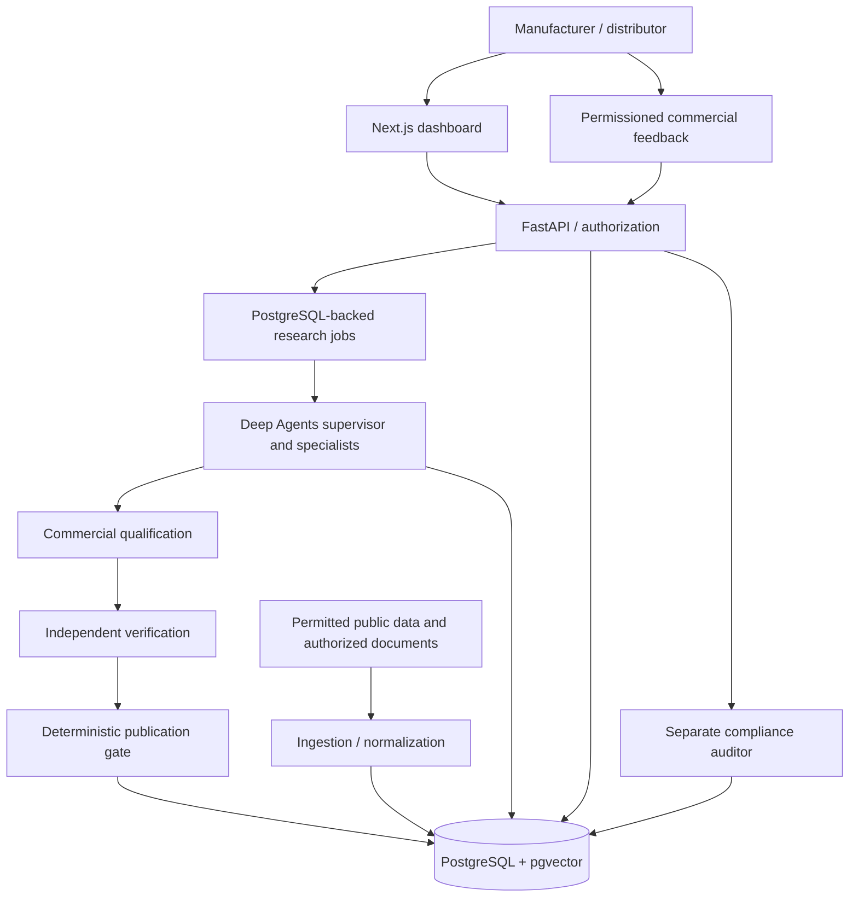

# Technical architecture

Design status: planned beyond foundation. See master-blueprint.md for the complete baseline.

## Boundaries

- Frontend: Next.js App Router, TypeScript strict, Tailwind CSS; shadcn/ui added when real components are needed. Server-side API origin; never expose database or service-role credentials. Public foundation page only.
- Backend: FastAPI, Pydantic, Python 3.12. API validates tenant and input, returns structured error codes. Only health routes implemented now. Domain modules: agents (supervisor/research/qualification/verification/tools), ingestion, knowledge_graph, opportunities, compliance, models, workers, services. Add code at owning checkpoint, not empty abstractions.
- Storage: PostgreSQL 16 with pgvector; SQL relations as the knowledge graph. Versioned migrations. S3-compatible private object storage for original documents and evidence. No separate vector or graph DB initially.
- Retrieval: SQL filters and full-text first, semantic search via pgvector when evaluated. Preserve stable entity IDs and timestamps. Product and evidence matching are separate from claims of demand.
- Agent engine: LangChain Deep Agents on LangGraph; provider-independent OpenAI/Gemini/Claude adapters. No framework/model dependencies installed until CP5 benchmark. Structured Pydantic contracts, bounded read-only tools, isolated subagents, persistent checkpoints, LangSmith traces with secrets/private data redacted.
- Jobs: PostgreSQL-backed worker with transaction-based leasing, idempotency keys, retry caps, cancellation, state and budget persisted per run. Planned states queued/running/partial/failed/cancelled/completed; publication state separate. Resume without duplicating paid tool calls when possible. No Redis/Kubernetes initially.
- Compliance is a separate document comparison workflow: PyMuPDF, python-docx, openpyxl; extract atomic requirement and manufacturer's statement, align semantics, apply deterministic numerical checks, preserve original wording and page/cell locators; report supported/mismatch/unclear and request clarification. Never create a compliance sheet or declare manufacturer commitments.
- Source adapters: OpenAlex API, ROR/Crossref as evaluated, institutional sites and permissible procurement, I-STEM, ANRF/SERB, GeM/CPPP subject to rights. BeautifulSoup and selective Playwright only for authorized access.
- Auth: Supabase Auth planned, server validates JWT and membership; organization scoped rows, explicit manufacturer-distributor grants and RLS/equivalent, no trust in client tenant IDs. Separate shared public facts from private profiles, documents, jobs and feedback. No live customer data in CP1.
- Deployment: local Compose now; Next.js on Vercel, FastAPI/worker on Railway, PostgreSQL/pgvector and Auth on Supabase, private S3-compatible storage at CP11. No cloud provisioning, billing or public deployment now.

## API roadmap

GET /health/live and GET /health/ready now. Later versioned /v1/products, /v1/research-runs, /v1/opportunities, /v1/evidence, /v1/feedback, /v1/compliance-audits with tenant enforcement and pagination. Research runs return job IDs, never block request threads for extended LLM work.

## Decisions

ADR-001: modular monolith + separate frontend; no microservices. ADR-002: Deep Agents as provisional primary harness; compare simpler alternatives and document changes. ADR-003: external mandatory verifier and deterministic publication gate. ADR-004: PostgreSQL and pgvector, local disposable Compose for CP1. ADR-005: staged schema and dependency installation; preserve original technology stack, defer unused libraries and exact locks until compatibility testing. ADR-006: review branch and explicit owner approval at each checkpoint. All decisions are proposals pending owner review; no unapproved scope changes.
